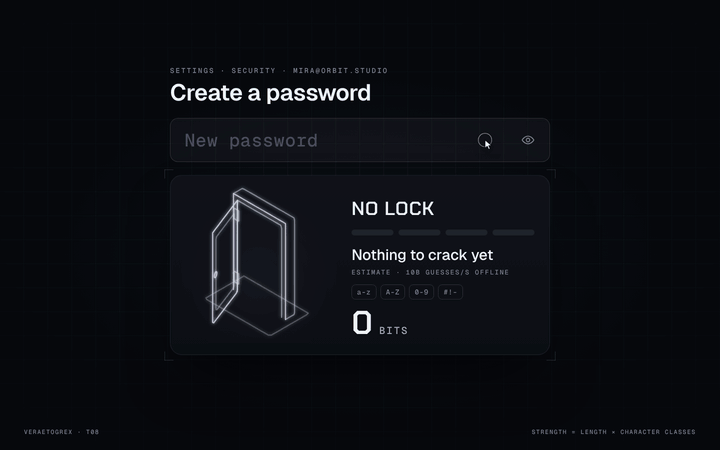

# Vault Meter

**Password meters are a bar. This one is a vault door.**



**Live demo:** [veraetogrex-portfolio.github.io/vault-meter](https://veraetogrex-portfolio.github.io/vault-meter/) · **Mockup:** [full-screen version](https://veraetogrex-portfolio.github.io/vault-meter/mockup/vault-meter.html)

Every level is the same 14 line strokes, re-shaped: open door → paperclip → padlock → deadbolt → bank vault. Lines morph into each other, they never cross-fade. Strength is estimated from length and character classes.

## Use it

Three files, no build step, no dependencies, no web fonts:

```
index.html   markup
style.css    styles and keyframes
script.js    behaviour
```

Download the repo and open `index.html`, or copy the three files into your project.

## Try it

- Type `neon`, then `neon-river-42` and watch the object change.
- Crack times are rough estimates, not a security audit.

## Make it yours

`estimate()` in `script.js` computes bits as length × log2(character pool). Swap it for zxcvbn or your own policy if you need a stricter one. Colours are CSS custom properties at the top of `style.css`.

`prefers-reduced-motion` is respected: heavy motion drops to short fades.

## What's in `mockup/`

The full 1440×900 screen this component was shot in for the reel:

- `mockup/vault-meter.html` — interactive. `D` plays the demo, `R` resets.
- `mockup/vault-meter.autoplay.html` — the scripted ~6 s loop with a drawn cursor.
- URL flags: `?frame` puts the screen in a browser window, `?clean` hides the control panel, `?once` plays the demo once.

The mockup uses a shared stage runtime and bundled fonts from `mockup/_shared/`. The component in the root doesn't need any of it.

---

Component 08 of a series. New one every day on Instagram [@veraetogrex_portfolio](https://www.instagram.com/veraetogrex_portfolio/) · all components: [github.com/veraetogrex-portfolio](https://github.com/veraetogrex-portfolio)

MIT licensed.
